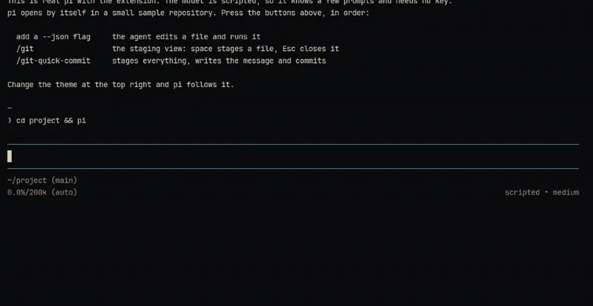

# pi-git

Stage, write and commit from inside the [pi coding agent](https://pi.dev). A quick commit stages everything, has the model write the message from the staged patch and commits it in the background, while you keep typing.

**[Try it in your browser](https://pi-git.soleone.xyz)**: real pi with the extension, on a scripted model and a git stand-in, so no key and nothing leaves the page.



## Install

```bash
pi install git:https://github.com/Soleone/pi-git
```

The extension requires pi 0.84.2 or a compatible release. It uses the public extension, model registry, and TUI APIs.

## Commands

Every command uses the `/git*` namespace:

| Command | Description |
| --- | --- |
| `/git` | Open the interactive staging view. |
| `/git-branch` | Switch, create, push, pull, or delete a branch. |
| `/git-commit [message]` | Open the manual commit editor or commit the supplied message. |
| `/git-amend` | Edit and amend the latest commit message without changing its content. |
| `/git-smart-commit` | Generate a reviewable commit draft and open the manual editor. |
| `/git-quick-commit` | Stage all changes, generate a message, validate the snapshot, and commit in the background. |
| `/git-quick-commit cancel` | Cancel an active quick-commit job before finalization. |
| `/git-settings` | Configure pi-git's global shortcuts and commit message model. |

The old `/branch`, `/commit`, `/smartcommit`, and `/quickcommit` names are not registered.

## Shortcuts

Defaults:

| Shortcut | Action |
| --- | --- |
| `Ctrl+\\` | Open `/git`. |
| `Alt+G` | Run `/git-quick-commit`. |

The manual commit editor keeps these fixed shortcuts:

| Shortcut | Action |
| --- | --- |
| `Ctrl+S` | Commit. |
| `Ctrl+R` | Rewrite the message. |
| `Ctrl+G` | Run Graphite create-and-commit. |

Use `/git-settings` to change or disable the two global bindings and choose the model used by smart and quick commit. The model defaults to `current`; press `m` in the settings dialogue to edit it. Scoped models from `/scoped-models` are shown as suggestions, while any available `provider/model-id` can be entered.

Settings are stored atomically at `$PI_CODING_AGENT_DIR/pi-git.json`, falling back to `~/.pi/agent/pi-git.json`. A reload is required and is performed automatically after saving:

```json
{
  "version": 1,
  "shortcuts": {
    "openStatus": "ctrl+\\",
    "quickCommit": "alt+g"
  },
  "commitModel": "current"
}
```

A `customFooter` key left over from earlier versions is ignored and dropped on the next save; the session status line now lives in [pi-statusline](https://github.com/Soleone/pi-statusline).

## Quick commit safety

Quick commit runs as one background job: `staging -> drafting -> validating -> finalizing -> committing`. You can cancel it until it starts finalizing; after that the commit and its hooks run to the end.

- **Refuses risky states**: no first commit yet, detached `HEAD`, a merge, rebase, cherry-pick or revert in progress, or no usable model.
- **Drafts from the staged patch only**, never the conversation. Large changes fall back to a zero-context patch, then to a skeleton that keeps every file and hunk header and lists what it left out. Nothing is cut silently.
- **Checks the snapshot** (branch, `HEAD`, index tree) right before committing, and stops if anything moved.
- **Commits with `git commit --file`**, so your hooks run as usual.
- **Shows what the message cost**, in the same shape as [pi-statusline](https://github.com/Soleone/pi-statusline): `$0.42 ⚡19.0M ↑264k ↓86k`.
- **Skips the model for pure reformatting**: those are committed as `style: format N files`.
- **Clears stale lock files** like a leftover `index.lock`, but only once no process holds them.

Budgets, the length-stop recovery ladder and the exact guarantees are in [docs/quick-commit.md](docs/quick-commit.md).

## Smart versus quick commit

- `/git-smart-commit` is reviewable. It generates a draft, preserves it when the editor is closed, and lets you edit, rewrite, or cancel before committing.
- `/git-amend` edits the latest commit message and uses `git commit --amend --only`, so staged changes are left staged rather than accidentally included. It asks for confirmation when the latest commit is present in a remote ref.
- `/git-quick-commit` is automatic. It stages all changes, generates and validates a message without replacing the main editor, and commits after the snapshot check. It intentionally does not handle an unborn repository.

Manual and smart commits can create the repository's first commit.

Quick and smart use one drafting policy: the staged snapshot, the project commit style, the model's thinking level, and nothing inferred from the conversation. They differ only around the draft - quick stages everything and commits it, smart keeps your staged subset and stops in the editor for you. A programmatic caller may still pass an explicit intent; that is the only non-Git text a model ever sees. Git's staged manifest, stats, and complete patch outrank style, explicit intent, and analyst interpretation.

If the complete compact evidence cannot fit the analyst or final request, generation stops with an actionable error. Select a larger-context model or stage a smaller change instead of receiving a stat-only or partial draft.

## Commit style

Add `COMMIT.md` to a project to customize generated messages. If it is absent, pi-git uses its bundled Conventional Commit guidance.

## Development

```bash
pnpm install --ignore-scripts
pnpm typecheck
pnpm test
pnpm validate
```

The test suite covers NUL-delimited Git status parsing, temporary repositories, snapshot policy, strict model output validation, quick-commit cancellation and timeouts, temporary-file cleanup, and shortcut persistence.

## Structure

```text
index.ts
src/
  register.ts
  git-service.ts
  commit-message.ts
  commit-evidence.ts
  commit-generator.ts
  quick-commit.ts
  shortcut-config.ts
  settings-dialog.ts
  commit-workflow.ts
  git-ui.ts
  ui/
```
